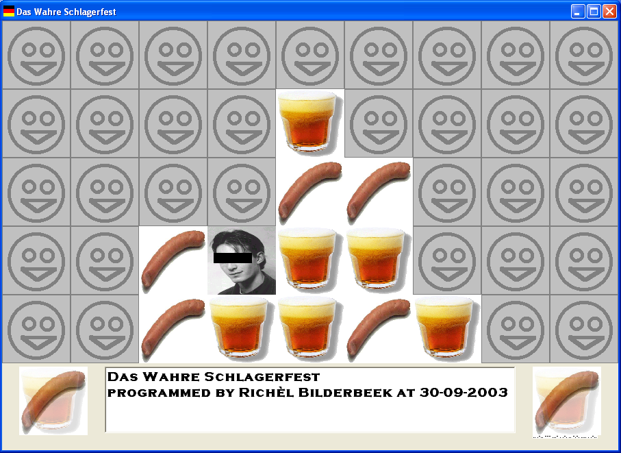

# Das Wahre Schlagerfest (VCL)

Das Wahre Schlagerfest (VCL) is one of [Richèl Bilderbeek's games](https://richelbilderbeek.github.io/games/).

The game Das Wahre Schlagerfest, using the C++ VCL library.

This game has been superseded by [Das Wahre Schlagerfest](https://richelbilderbeek.github.io/das_wahre_schlagerfest/).

## Screenshots

## Links

- [Source code](https://github.com/richelbilderbeek/DasWahreSchlagerfestVcl)
